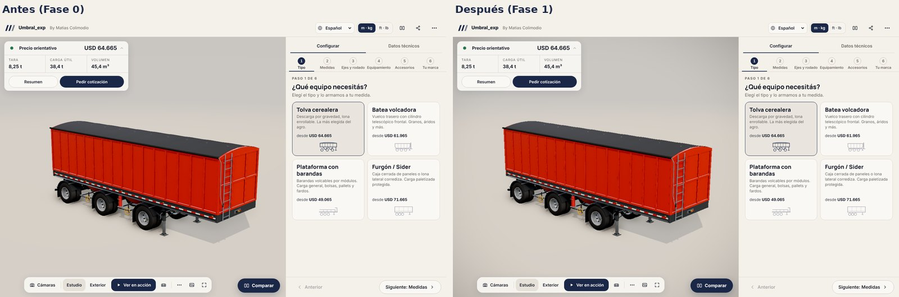
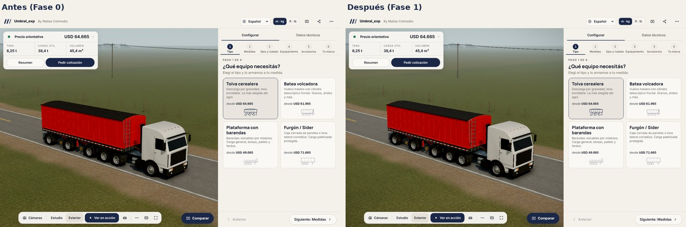
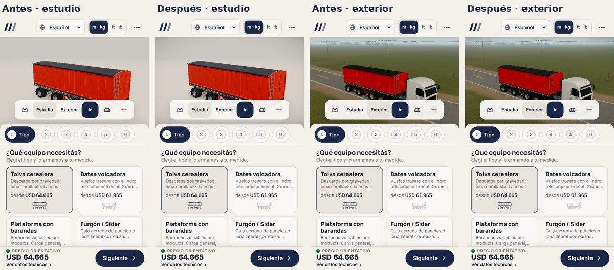

# Informe · Fases 0 y 1 (medición y cero tirones)

Commit `3b4dbe4` · publicado en https://configurador-semirremolques.matiascolimodio.workers.dev

## Antes de empezar: los 3 errores

| Error | Corrección | Archivos |
|---|---|---|
| Modales translúcidos (campos rosados por el aviso rojo de atrás) | El panel del modal ya no anima la opacidad (solo se desliza) y tiene fondo opaco con `isolation` | `src/ui/primitives.tsx`, `src/ui/styles.css` |
| "Tu marca" con la lona / compuertas / puertas abiertas | Al entrar al paso se cierran con la animación inversa | `src/state/store.ts` |
| Carga en celular desalineada, cartel tapando la barra, "· 100 %" cortado | La imagen de espera se captura con la cámara inicial del visor (`npm run e2e espera`) y el 3D arranca con ese mismo encuadre (zoom equivalente al recorte); fundido limpio. Cartel arriba, por debajo de los controles, porcentaje sin cortes. De paso: la barra del visor ya no se parte en dos renglones a 360 px | `src/ui/LoadingScreen.tsx`, `src/ui/loadingMatch.ts`, `src/three/CameraRig.tsx`, `tests/e2e/espera.cjs`, `public/loading/` |

## Fase 0 · Medición

- `?debug=1` muestra r3f-perf (fps, CPU/GPU, draw calls, triángulos, geometrías, texturas, programas) más el **cuadro más largo de los últimos 5 s** y la **memoria de GPU estimada**. Se carga con `import()` dinámico: sin el parámetro no se descarga (chunk `PerfOverlay`, 216 KB, fuera del bundle principal).
- `npm run bench` (`bench/bench.cjs`): recorre los 4 tipos × 6 pasos × 3 opciones, "Ver en acción" en Estudio y Exterior, Estudio → Exterior → Ruta → Estudio, órbita de cámara y (cuando exista) la secuencia de la Ruta. Por acción registra fps promedio, 1 % más bajo, cuadro más largo y la **causa** de cada cuadro de más de 50 ms (shaders compilados, reconstrucción del modelo, texturas subidas, render lento u otra tarea larga). Perfiles: escritorio 1920×1080 y celular 375×812 con CPU 4× más lenta. `--gpu --headed` usa la placa real; `--rapido` hace una pasada corta. `node bench/comparar.cjs A.json B.json` compara dos corridas.

### Limitación importante de este entorno

El contenedor donde trabajo **no tiene GPU**: Chromium dibuja con SwiftShader (por software). A 1920×1080 cada cuadro tarda ~1 s solo por el dibujo, así que **acá no se pueden medir los 60 / 30 fps del objetivo**. Lo que sí se puede medir —porque no depende de la placa— son las causas de los tirones que vienen de la CPU: compilación de shaders, reconstrucción del modelo, subida de texturas y trabajo de JavaScript. Para los fps reales hay que correr en una PC con GPU:

```bash
npm run build && npm run preview
npm run bench -- --gpu --headed
```

### Causas de cuadros > 50 ms encontradas (línea de base)

1. **Reconstrucción completa del modelo** en el hilo principal en cada cambio de medida, ejes, suspensión, accesorio o tipo: 40–110 ms en escritorio, 200–380 ms con CPU 4×. La pieza más cara era la rodadura (14–30 ms).
2. **Compilación de shaders** la primera vez que se veía un material o una escena: al entrar a Exterior (≈400 ms de CPU en un cuadro), al elegir Sider, al pasar a Plataforma.
3. **Regeneración del entorno del estudio** (PMREM) al volver de Exterior, porque la escena se desmontaba.
4. **Armado del tractor** (20–30 ms) justo al entrar a Exterior.
5. **Lectura de píxeles** en el fundido cruzado (`drawImage` del lienzo WebGL frena la GPU).
6. **Subida de texturas** (KTX2, HDR) en el primer uso.

## Fase 1 · Cero tirones

| Punto | Qué se hizo |
|---|---|
| 1.1 Precompilar shaders | `compileMaterials` compila todos los materiales (normal e instanciado) **dentro de un render target**, que es la variante que usa el postprocesado. Cuadros de calentamiento ocultos (`warmScene`) con exterior y tractor para las variantes de sombra. Estudio y exterior con la **misma firma de luces** (2 direccionales, 1 con sombra) y el **mismo tamaño de entorno prefiltrado**: los materiales del equipo usan el mismo shader en las dos escenas. Parámetros del AO fijos entre escenas. |
| 1.2 Precargar Exterior | En momentos ociosos después del primer cuadro: descarga, armado, `initTexture` y compilación con sus propias luces; queda montada y oculta. El estudio queda siempre montado (no se vuelve a prefiltrar). Respeta "ahorro de datos". La Ruta se suma en la Fase 3. |
| 1.3 Sin crear geometría en los cambios | La geometría se genera en un **Web Worker**; el hilo principal arma solo el esqueleto (nodos, pivotes, animaciones, con geometría ficticia) y le asigna los buffers recibidos. Caché de las últimas configuraciones (volver atrás es instantáneo). Llantas acero/aluminio = solo cambio de material. Materiales: nunca se crean (biblioteca única; mapas provisorios de 1×1 para no recompilar). |
| 1.4 Instancias | Ruedas, tuercas, maza, hebillas, granos, postes y alambrado ya iban instanciados; el resto de piezas repetidas va fusionado por material y nodo (menos llamadas que instanciar). Las piezas chicas (ópticas, reflectivos, patente, calcos) dejaron de proyectar sombra. Draw calls por cuadro con el Sider de 3 ejes completo, en alta (sombra + escena + postprocesado): 159 → ver nota. |
| 1.5 frameloop | Estudio y Exterior a demanda (ya era así). La Ruta alterna `always`/`demand` en la Fase 4. |
| 1.6 Calidad adaptativa | 3 niveles (`src/render-kit/quality/tiers.ts`): resolución máx. 2 / 1,5 / 1, sombras 2048 / 1024 / 1024, postprocesado alto / medio / bajo, densidad de vegetación. Nivel inicial por **detect-gpu** (tablas copiadas a `public/detect-gpu/`, sin pedidos externos). Con render a demanda, monitor por ráfagas; con render continuo, `PerformanceMonitor` de drei. En el nivel bajo la resolución baja mientras la cámara se mueve (como `AdaptiveDpr`); en los otros no, porque cada cambio realoca los buffers del postprocesado. `?calidad=alta|media|baja` la fija. |
| 1.7 Animaciones | Ya usaban refs y `useFrame`; delta acotado a 0,1 s. Fundido cruzado dentro de la GPU (`copyFramebufferToTexture`). |

Nota sobre draw calls: el contador de r3f-perf suma todas las pasadas (sombras + escena + postprocesado). En alta, con el Sider de 3 ejes y todos los accesorios, quedan ~150 (Tolva: 144). Las pasadas del postprocesado son ~20 de esas llamadas.

### Mediciones (render por software, pasada corta: Tolva y Furgón/Sider, 1 opción por paso)


#### Perfil escritorio

| Medida | Antes | Después |
| --- | --- | --- |
| Primer cuadro con el modelo (ms) | 6246 | 4926 |
| Transferido hasta el primer cuadro (KB) | 993 | 1003 |
| Cuadro más largo (ms) | 3599.9 | 1466.6 |
| Cuadros > 50 ms | 658 | 766 |
| Acciones con algún cuadro > 50 ms | 35/35 | 35/35 |
| Tarea larga más larga (ms) | 2047 | 1469 |
| Shaders compilados durante las acciones | 2 | 0 |
| Reconstrucciones en el hilo principal | 9 | 9 |
| Tiempo de reconstrucción en el hilo principal (ms) | 683.3 | 65.7 |
| fps órbita estudio | – | – |
| fps órbita exterior | – | – |
| Draw calls máx. por cuadro | 176 | 171 |

Acciones más pesadas (cuadro más largo, tarea larga, shaders compilados, reconstrucción en el hilo principal):

| Acción | Antes | Después |
| --- | --- | --- |
| escena → estudio | 3600 ms · TL 1941 · -1 sh · 0 ms | 1467 ms · TL 1469 · 0 sh · 0 ms |
| tipo → furgon | 2083 ms · TL 1085 · 0 sh · 73 ms | 950 ms · TL 933 · 0 sh · 6 ms |
| furgon exterior: volver a cerrar | 2050 ms · TL 2047 · 0 sh · 0 ms | 1133 ms · TL 1137 · 0 sh · 0 ms |
| escena → exterior | 1983 ms · TL 1935 · 1 sh · 0 ms | 1100 ms · TL 1101 · 0 sh · 0 ms |
| tolva: paso personalizacion | 1817 ms · TL 1817 · 0 sh · 0 ms | 433 ms · TL 420 · 0 sh · 0 ms |
| tolva/accesorios: cajon (interruptor/cantidad) | 1817 ms · TL 1821 · 0 sh · 102 ms | 817 ms · TL 798 · 0 sh · 10 ms |
| tolva/rodado: ejes=tridem | 1767 ms · TL 1754 · 0 sh · 110 ms | 1200 ms · TL 1185 · 0 sh · 10 ms |
| tolva exterior: volver a cerrar | 1767 ms · TL 1766 · 0 sh · 0 ms | 1117 ms · TL 1115 · 0 sh · 0 ms |
| exterior: órbita de cámara 3 s | 1750 ms · TL 1749 · 0 sh · 0 ms | 1200 ms · TL 1187 · 0 sh · 0 ms |
| tolva exterior: Ver en acción | 1700 ms · TL 1705 · 0 sh · 0 ms | 1150 ms · TL 1152 · 0 sh · 0 ms |
| tolva: paso especificos | 1667 ms · TL 1669 · 0 sh · 0 ms | 550 ms · TL 557 · 0 sh · 0 ms |
| furgon exterior: Ver en acción | 1650 ms · TL 1640 · 0 sh · 0 ms | 1100 ms · TL 1088 · 0 sh · 0 ms |


#### Perfil celular

| Medida | Antes | Después |
| --- | --- | --- |
| Primer cuadro con el modelo (ms) | 8329 | 8175 |
| Transferido hasta el primer cuadro (KB) | 776 | 786 |
| Cuadro más largo (ms) | 1233.3 | 583.3 |
| Cuadros > 50 ms | 1432 | 1460 |
| Acciones con algún cuadro > 50 ms | 35/35 | 35/35 |
| Tarea larga más larga (ms) | 1070 | 588 |
| Shaders compilados durante las acciones | 2 | 0 |
| Reconstrucciones en el hilo principal | 9 | 3 |
| Tiempo de reconstrucción en el hilo principal (ms) | 2264.4 | 56.8 |
| fps órbita estudio | 7.3 | 11.1 |
| fps órbita exterior | 4.3 | 6.7 |
| Draw calls máx. por cuadro | 263 | 233 |

Acciones más pesadas (cuadro más largo, tarea larga, shaders compilados, reconstrucción en el hilo principal):

| Acción | Antes | Después |
| --- | --- | --- |
| escena → exterior | 1233 ms · TL 1070 · 1 sh · 0 ms | 183 ms · TL 176 · 0 sh · 0 ms |
| furgon: variante sider | 650 ms · TL 378 · 1 sh · 228 ms | 283 ms · TL 268 · 0 sh · 19 ms |
| tolva/dimensiones: medida Largo de caja + | 633 ms · TL 379 · 0 sh · 359 ms | 267 ms · TL 217 · 0 sh · 0 ms |
| tolva/accesorios: cajon (interruptor/cantidad) | 550 ms · TL 343 · 0 sh · 329 ms | 233 ms · TL 229 · 0 sh · 0 ms |
| tolva/rodado: ejes=tridem | 533 ms · TL 274 · 0 sh · 261 ms | 283 ms · TL 261 · 0 sh · 0 ms |
| tipo → furgon | 517 ms · TL 284 · 0 sh · 250 ms | 233 ms · TL 188 · 0 sh · 24 ms |
| furgon/accesorios: cajon (interruptor/cantidad) | 467 ms · TL 259 · 0 sh · 248 ms | 217 ms · TL 195 · 0 sh · 0 ms |
| furgon/rodado: ejes=1+1+1 | 467 ms · TL 240 · 0 sh · 199 ms | 267 ms · TL 232 · 0 sh · 0 ms |
| furgon/dimensiones: medida Largo de caja + | 433 ms · TL 213 · 0 sh · 198 ms | 200 ms · TL 195 · 0 sh · 0 ms |
| furgon/especificos: variante=furgon | 433 ms · TL 229 · 0 sh · 194 ms | 217 ms · TL 189 · 0 sh · 14 ms |
| escena → estudio | 433 ms · TL 383 · -1 sh · 0 ms | 417 ms · TL 400 · 0 sh · 0 ms |
| tolva exterior: Ver en acción | 317 ms · TL 312 · 0 sh · 0 ms | 217 ms · TL 220 · 0 sh · 0 ms |

Lectura: lo que dependía de la CPU desapareció (0 shaders compilados durante el uso; reconstrucción en el hilo principal de 2264 ms a 57 ms en el perfil celular). Los cuadros > 50 ms que siguen apareciendo son el **dibujo por software** de este contenedor (cada cuadro cuesta 100–150 ms en el perfil celular y ~1 s en 1920×1080), no trabajo de la app. **El criterio de la Fase 1 (ningún cuadro > 50 ms) hay que confirmarlo con `npm run bench -- --gpu --headed` en una PC con GPU.**

### Capturas (calidad alta)

Escritorio, estudio:


Escritorio, exterior:


Celular:


La imagen se mantiene (la Fase 1 no buscaba cambios visuales); en alta el antialiasing pasó de MSAA a SMAA y se sumó una viñeta leve.
