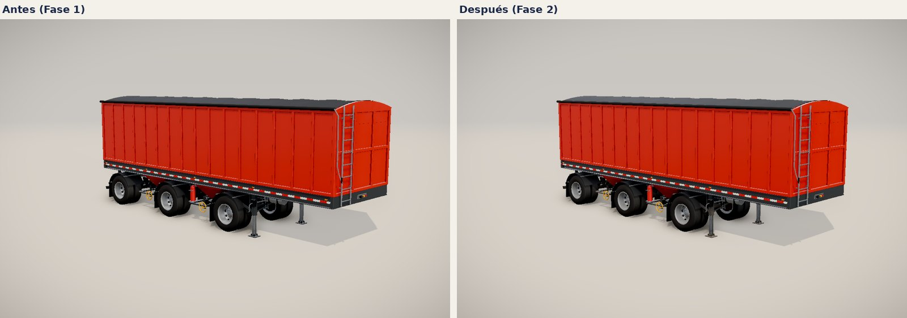
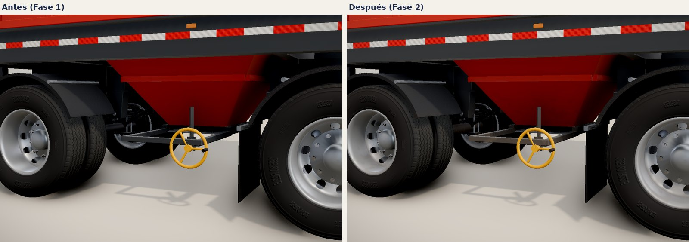
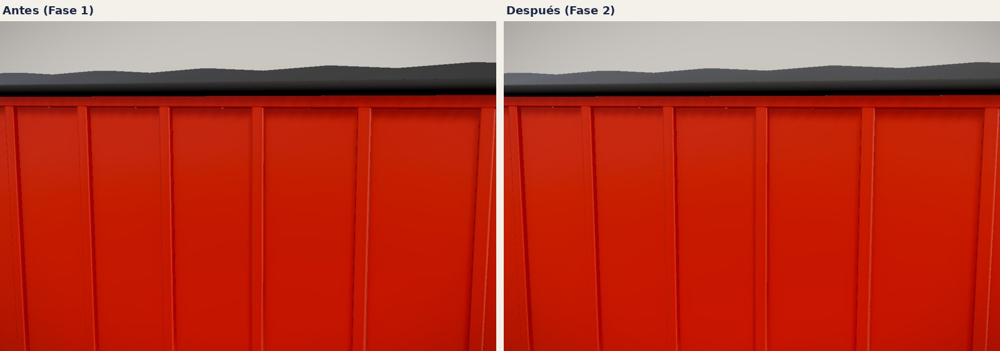
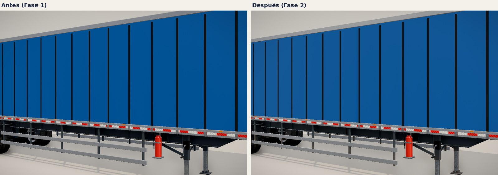
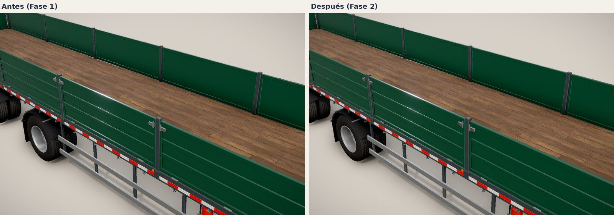

# Informe · Fase 2 (luz y materiales)

## Qué cambió

| Punto | Qué se hizo | Archivos |
|---|---|---|
| 2.1 Tono y exposición | AgX (ya estaba) con salida sRGB. **Exposición por escena** con un efecto propio controlado por uniform (`ExposureEffect`): cambiarla no recrea el postprocesado ni compila shaders. | `src/render-kit/post/Exposure.tsx`, `src/three/Effects.tsx` |
| 2.2 Estudio | Entorno HDR de estudio + softboxes; luz principal direccional suave con sombra PCF suave; relleno frío; **contraluz** alto por detrás (filo de luz en el contorno, separa el semi del fondo); piso con sombra de contacto; fondo en degradé. | `src/three/Studio.tsx` |
| 2.3 Exterior / Ruta | Cielo HDR CC0 de Poly Haven (1k para iluminar, 4k solo de fondo), sol direccional alineado con el del HDR, sombras PCF suaves, bruma por distancia del tono del horizonte. El encuadre de sombras que sigue al camión se termina en la Fase 4 (el camión queda en el origen y se mueve el mundo, así que el frustum de sombra ajustado al conjunto cumple el papel de las cascadas cercanas). | `src/three/Exterior.tsx` |
| 2.4 Materiales | Pintura de caja y chasis: physical con clearcoat 0,42 / 0,32, rugosidad 0,38 / 0,45 y **piel de naranja** muy leve en el normal del barniz (respeta el RAL elegido). **Suciedad y salpicaduras** en la parte baja (máscara por altura en espacio de mundo + ruido): chasis, guardabarros/barreros, llantas y bajos de la caja. Galvanizado con metalness 1, rugosidad 0,35–0,6 y flor de zinc (KTX2). Llanta de aluminio pulido con **anisotropía**; llanta de acero semimate. Neumáticos con dibujo y texto del flanco en relieve. Lona de PVC con **sheen** y trama (fabric_normal.ktx2), color elegido intacto. Fenólico marrón con veta. Ópticas emisivas que el bloom toma solo encendidas. Logo y texto proyectados en el shader (siguen pliegues y corrugado). | `src/three/materials.ts`, `src/render-kit/materials/patch.ts`, `src/three/kit/tex.ts` |
| 2.5 Postprocesado | Alto: N8AO + SMAA + bloom muy sutil + viñeta leve. Medio: N8AO a media resolución + SMAA. Bajo: solo FXAA. La profundidad de campo "solo al quedarse quieto" se hace dentro del refinado de la Fase 5 (un cuadro quieto se puede permitir el costo; en movimiento no se paga). | `src/three/Effects.tsx` |

Todos los parches de shader se encadenan con una clave de programa estable (`patchMaterial`) y entran en la precompilación de la Fase 1: **0 shaders compilados durante el uso** también con los materiales nuevos.

### Lo que quedó distinto a lo pedido

- **Texturas en KTX2 + AO horneado**: las texturas fotográficas (asfalto, campo, ripio, madera, chapa, tejido, galvanizado) ya están en KTX2. Las procedurales (desgaste, piel de naranja, dibujo del neumático, cinta reflectiva) se generan en el navegador porque dependen de parámetros (texto del neumático, etc.). La oclusión horneada en un segundo UV necesita modelos exportados de Blender (Fase 6); con la geometría procedural la oclusión la da N8AO y, al quedarse quieto, el refinado de la Fase 5.
- **Desenfoque de movimiento en la Ruta**: opcional; se evalúa en la Fase 4.

## Capturas (calidad alta, render por software)

Tres cuartos:

Ruedas y parte baja (suciedad, aluminio, galvanizado):

Barniz con piel de naranja (caja de la tolva):

Lona del Sider (sheen):

Piso de la plataforma:

## Mediciones

Los cambios son de shader (mismo número de mallas y de draw calls). Con el render por software no hay fps representativos; lo verificable acá: 0 compilaciones durante el uso y mismas draw calls que la Fase 1. Los fps reales se confirman con `npm run bench -- --gpu --headed` (ver Fase 7).
