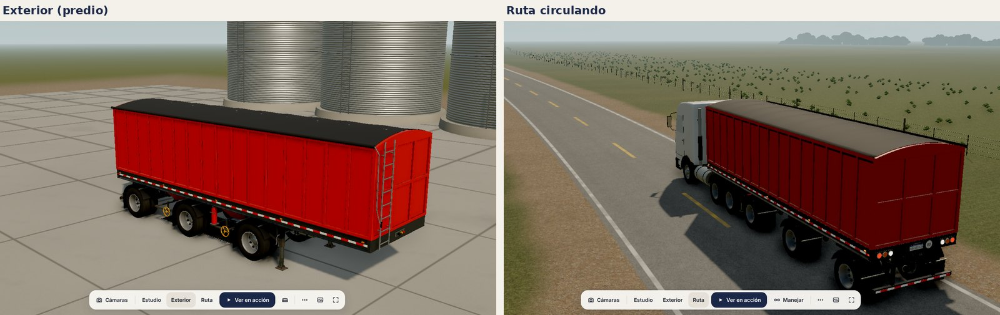
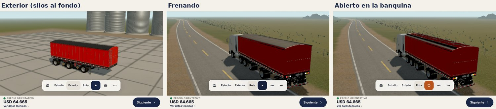
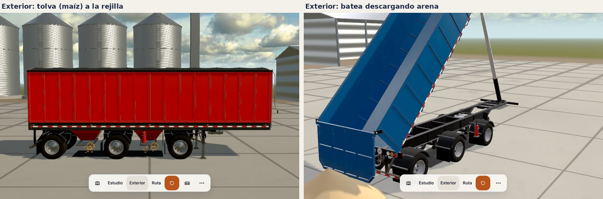
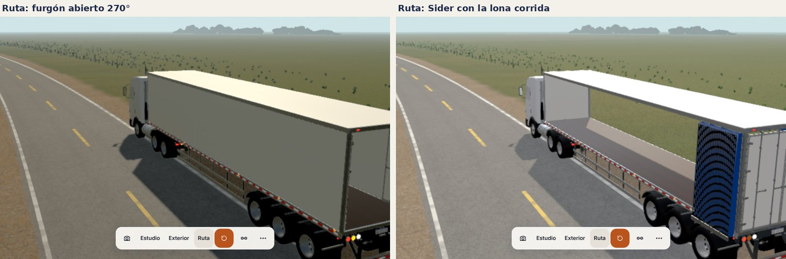

# Informe · Fases 3 y 4 (escenas creíbles y el camión en la ruta)

## Escenas

| Escena | Qué tiene | Archivos |
|---|---|---|
| **Estudio** | Sin cambios de fondo (Fase 2). Siempre montado. | `src/three/Studio.tsx` |
| **Exterior** (nuevo: predio de acopio) | Piso de hormigón con juntas cada 5 m, manchas y rugosidad variable, sin patrón repetido visible (dos escalas mezcladas + ruido de gran escala); ripio y campo afuera. **Rejilla de descarga** bajo las bocas de la tolva (se reacomoda sola con el modelo, sin generar geometría). Cuatro **silos** de chapa ondulada con techo cónico, escaleras, anillos y pasarela, torre de elevación y un **galpón** con techo a dos aguas, todo 3D, con bruma de distancia. El tractor no aparece (como en el estudio). | `src/three/Exterior.tsx`, `src/three/outdoor.ts` |
| **Ruta** (nueva) | Ruta argentina de dos carriles con **curvas suaves y largas**: asfalto con normal y rugosidad variable y huellas de rodada, parches, bordes desgranados; **demarcación**: eje amarillo discontinuo y bordes blancos continuos, gastados; banquina de ripio y pasto; alambrado con postes, varillas e hilos; línea de postes de luz con cables; **mojón kilométrico** y **cartel de velocidad máxima** en 3D; campo con **soja en hileras** a la derecha y **rastrojo** a la izquierda (densidad según calidad); montes en el horizonte como impostores. **Ruta infinita**: el camión queda en el origen y se mueve el mundo; suelo y objetos se reciclan en la GPU. | `src/three/Route.tsx`, `src/render-kit/vehicle/roadInstancing.ts` |

Las tres escenas comparten la misma firma de luces y entorno (Fase 1): **cambiar de escena no compila nada** y las tres quedan precargadas en segundo plano.

## "Ver en acción" con carga (Exterior)

- **Tolva**: el grano cae por las bocas a la rejilla (partículas instanciadas, sin montículos); el color sigue a "Producto a cargar" (soja, maíz, trigo, girasol). En el estudio sigue formando montículos en el piso.
- **Batea**: vuelco con el cilindro telescópico por etapas (ya existía) y ahora **el material se desliza** fuera de la caja y forma una pila detrás (arena, piedra partida o grano, con su color).
- **Plataforma**: barandas volcando por módulos (ya existía).
- **Furgón**: puertas traseras a **270°** hasta trabarse contra el lateral.
- **Sider**: correr lona (Fase anterior: hebillas, lona en acordeón con pliegues reales, parantes que se deslizan o se desmontan, tablillas, techo corredizo).

## Tractor

Cabina con interior visible (tablero, asientos, volante), **vidrio físico con transmisión** en calidad alta (en media y baja, vidrio transparente: la transmisión agrega una pasada de render), espejos, faros, guiños, guardabarros, tanque de combustible, caja de baterías, plato de enganche, mangueras espiraladas al semi y **duales atrás**. Sin marca. Coincide con "Tractor considerado" (4×2 o 6×2) y con la distancia del perno rey que usan los cálculos legales. En la Ruta aparece siempre; en Estudio y Exterior, como hoy (oculto, se puede mostrar desde "···"). Se arma en el Web Worker y queda listo de antemano.

No se usó un modelo de Sketchfab / Poly Pizza: el procedural ya respeta las medidas legales y no trae marcas; un modelo externo habría que adaptarlo a 4×2 / 6×2 y a la distancia del perno rey de cada configuración.

## El camión en la ruta (Fase 4)

| Punto | Cómo quedó |
|---|---|
| 4.1 Movimiento | 80 km/h de crucero; aceleración ~0,75 m/s²; **frenado planificado de 80 a 0 en ≈5,5 s** con la desaceleración volviendo a cero al detenerse (sin golpe). Ruedas a **ω = v/r** con el radio de cada neumático (semi, tractor y delanteras: error 0 % por construcción; test < 2 %). **Modelo de remolque** desde el perno rey con L = perno rey – centro del grupo de ejes de la configuración (cambia con el largo y los ejes). Cabeceo al frenar/acelerar, rolido en curva, vibración mínima; neumática más suave que elásticos. Luces: posición siempre, freno al frenar, giro al cambiar de carril, balizas detenido. |
| Eje elevable | "Producto a cargar" no tiene un estado "vacío" (soja, maíz, trigo, girasol, arena, piedra): **en la ruta el eje queda siempre bajo**, como pediste para ese caso. |
| 4.2 Cámaras | Seguimiento (por defecto, atrás y arriba a 3/4 con resorte), lateral paralela y dron, en el menú "Cámaras" con la ruta a la vista. Se puede orbitar alrededor del camión mientras circula (la órbita es relativa al conjunto) y al soltar vuelve suave a la cámara elegida. |
| 4.3 Máquina de estados | En `render-kit/vehicle/actionMachine.ts`, reusable. CIRCULANDO → FRENANDO (giro a la derecha, a la banquina, frena) → DETENIDO (balizas) → ABRIENDO → ABIERTO → CERRANDO → DETENIDO → ARRANCANDO (giro a la izquierda, vuelve al carril, acelera) → CIRCULANDO. Botón: "Frenando…", "Abriendo…", "Cerrando…" deshabilitados; "Volver a cerrar" cierra, espera 1 s y arranca; toques repetidos se ignoran; cambiar opciones en cualquier estado; cambiar de tipo abierto cierra sin animación y queda detenido; salir abierto llega abierto y quieto; volver aparece detenido y arranca solo si está cerrado; "Tu marca" cierra, detiene y pone la cámara lateral; pestaña oculta: el reloj se pausa; movimiento reducido: arranca detenido con botón **"Arrancar"**. |
| 4.4 Acción por tipo | Tolva: compuertas (cremallera girando) + enrollar lona; Batea: vuelco por etapas y portón; Plataforma: barandas por módulo; Furgón: puertas a 270°; Sider: correr lona. Vacío: no cae carga. |
| 4.5 Captura PNG | Pausa el reloj del vehículo mientras se dibuja la captura (sale nítida aunque circule). |
| 4.6 Manejar | Hecho: botón "Manejar" en la ruta; W/S (o flechas) acelerar/frenar, A/D volante; joystick táctil en celulares. Modelo de bicicleta para el tractor y de remolque para el semi; velocidad máx. 90 km/h, volante y articulación acotados, se queda dentro de la ruta. A los 2 s sin tocar nada vuelve el piloto automático. |
| frameloop | `always` mientras el camión circula, anima o la cámara se mueve; detenido y quieto vuelve a `demand`. |

## Verificación

- `tests/unit/vehiculo.test.ts`: eje periódico; frenado 80 → 0 entre 4 y 6,5 s sin golpe final; ruedas sin patinar; articulación < 0,2 rad en todo el recorrido (el semi nunca se cruza); la articulación crece con el largo; máquina de estados completa y cambio de tipo abierto.
- `npm run e2e ruta` (navegador): circula a 80 km/h; "Frenando…" deshabilitado; **la animación nunca empieza con el camión en movimiento**; abre; "Volver a cerrar" cierra y arranca; cambio de tipo abierto; "Arrancar"; "Tu marca"; volver a la ruta.
- Con el render por software el camión se ve en cámara lenta (cada cuadro tarda ~1–2 s y el paso de tiempo está acotado a 0,1 s); en el navegador real va a tiempo real.

## Capturas

Exterior (predio) y Ruta:

Exterior, frenando y abierto en la banquina:

"Ver en acción" en el Exterior con carga visible:

Ruta: furgón y Sider abiertos:

## Lo que no se hizo

- Desenfoque de movimiento en la Ruta (era opcional): no; el costo de una pasada de velocidad por objeto no se justifica a 80 km/h con cámara que sigue al camión.
- Cascadas de sombra (CSM) propiamente dichas: como el camión no sale del origen, el encuadre de sombras ajustado a los 18 m del conjunto cumple el papel de la cascada cercana; lo lejano (postes, árboles) no proyecta sombras dinámicas.
