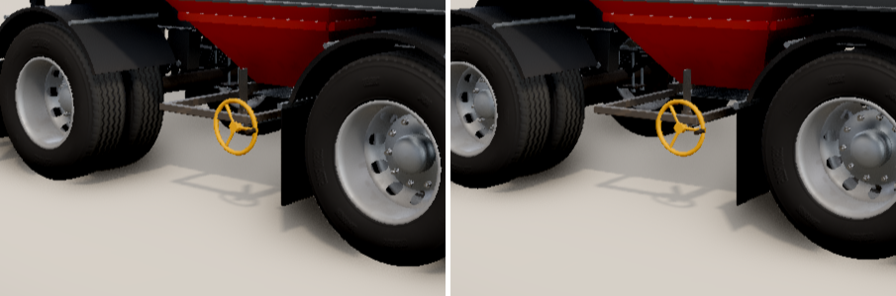

# Informe · Fase 5 (refinado al quedarse quieto)

## Qué se hizo

- **Refinado progresivo** (`src/render-kit/refine/`): cuando la cámara y la escena no cambian durante **800 ms**, se dibujan cuadros con jitter y se muestra su promedio, que converge a una imagen de producto:
  - jitter **subpíxel** (secuencia de Halton) → antialiasing completo;
  - **disco de luz** (la principal con sombra se mueve dentro de un disco) → sombras suaves, con penumbra;
  - **apertura de lente** con el plano de foco fijo en el objetivo de la cámara → profundidad de campo suave (solo Estudio, calidad alta).
  - Muestras por nivel: alta 96, media 48 (sin profundidad de campo), baja 16 (solo antialiasing).
  - En la Ruta, solo con el camión DETENIDO o ABIERTO.
- **Corte inmediato**: cualquier toque, rueda, tecla o cambio de estado (opciones, colores, escena, modelo nuevo) lo corta en el mismo cuadro; ese cuadro ya se dibuja en tiempo real (sin parpadeo). Mientras nada cambie, la imagen refinada se mantiene aunque se dibujen cuadros extra.
- La acumulación es GPU → GPU (`copyFramebufferToTexture` + mezcla en render targets de media precisión): no lee píxeles a la CPU.
- **Capturas refinadas** con **barra de progreso** y **tope de 4 s**: "Captura PNG" (hasta 4 s), las tres vistas del Resumen y del PDF (4 s en total). En la Ruta la captura pausa el reloj del camión.

## Por qué no el path tracer (opción A)

`three-gpu-pathtracer` traza sus propios materiales: no ejecuta los shaders propios del configurador. En la imagen refinada **desaparecerían el logo y el texto del cliente** (se proyectan en el shader de la pintura y de la lona), la suciedad de la parte baja y los pisos del Exterior y la Ruta (también son shaders). En un configurador donde el cliente sube su marca, eso no es aceptable. La opción B (acumulación) conserva todo y da antialiasing, sombras suaves y profundidad de campo; los rebotes de luz los aporta el entorno HDR y la oclusión ambiental (N8AO). Si más adelante los modelos vienen de Blender con el logo en una textura (Fase 6), el path tracer se puede sumar en alta.

## Imagen del link compartido (og)

`og.jpg` es una imagen fija: generar una imagen por configuración necesita un servidor que dibuje 3D, y la demo no tiene servidor.

## Captura (calidad alta, render por software)

Izquierda: tiempo real. Derecha: refinado al quedarse quieto (bordes sin dentado, sombra suave, fondo apenas desenfocado).

## Criterio

La captura quieta a los pocos segundos se ve sin ruido ni aliasing, con sombras suaves. "Al rotar se mantienen los 60 fps" no se puede medir acá (sin GPU); el refinado no corre mientras la cámara se mueve, así que no resta fps al rotar.
