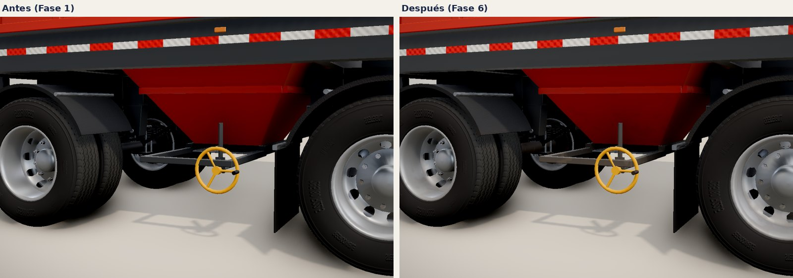
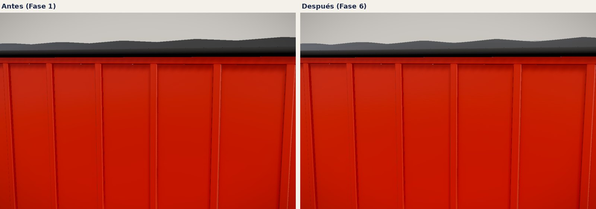

# Informe · Fase 6 (pipeline de modelos)

## Qué se hizo

| Punto | Qué quedó | Archivos |
|---|---|---|
| 6.1 Especificación | `docs/model-spec.md`: GLB en metros, Y arriba, frente a +Z (el cargador lo gira); origen de cada pieza móvil en su eje (perno rey, ruedas, compuertas, cada etapa del cilindro, bisagra trasera de la batea, módulos de baranda, puertas, parantes sobre el riel, rodillo de la lona, eje elevable); **todos los nombres de nodos que usa hoy el código** y su equivalente en la convención pedida; puntos de interés `hs_<id>`; piezas modulares de referencia; presupuestos (Estudio ≤ 400 k, rueda ≤ 6 k, tractor ≤ 120 k, Ruta ≤ 600 k); chaflanes; nombres de materiales (`paint_box`, `paint_chassis`, `galvanized`, `rim_steel`, `rim_alu`, `rubber`, `tarp`, `reflective`, `light_lens`, `floor_phenolic`, `floor_checker`, `plastic_black`, `decal`) y su material del código; AO en un segundo UV. | `docs/model-spec.md` |
| 6.2 Build | `npm run models:build` (glTF-Transform): `models/src/*.glb` → `public/models/`: dedup, prune, weld, resample, **meshopt**, texturas a **KTX2** (UASTC normales / ETC1S color, con `toktx` instalado) o WebP, máximo 2048 px; además `<nombre>-low.glb` (geometría al 25 %, texturas de 512 px) para la carga progresiva. Probado con una rueda de prueba: 149 KB → 21 KB (completa) y 24 KB / 767 triángulos (liviana). | `scripts/models-build.mjs`, `models/src/` |
| 6.3 Geometría procedural | Chaflán en todas las piezas grandes con espesor (antes, aristas vivas); rueda completa ajustada al presupuesto: **6,1 k triángulos** (antes 11,2 k) con neumático redondo, llanta con agujeros reales y tuercas instanciadas; lona de la tolva con **comba entre arcos** más marcada. | `src/three/kit/geo.ts`, `src/three/parts/wheels.ts`, `src/three/parts/tarp.ts` |
| 6.4 Carga progresiva y LOD | `loadProgressive()` (liviana primero, completa con fundido de 300 ms) lista para los GLB. Con la geometría procedural, la "versión liviana" es la imagen de espera calzada con la cámara inicial (aparece en < 0,5 s) y el 3D entra con fundido. **LOD de ruedas** (semi y tractor): detalle alto (6,1 k) cerca y bajo (1,6 k, sin tuercas) desde ~30 m, con histéresis y geometrías generadas de antemano (cambiar de nivel no genera nada). Objetos de la Ruta: ya son de pocos triángulos y su cantidad depende del nivel de calidad. | `src/render-kit/models/progressive.ts`, `src/three/TrailerObject.tsx` |

## Triángulos (contando instancias de ruedas)

| Equipo | Semi (sin ruedas) | Ruedas | Total |
|---|---|---|---|
| Tolva 3 ejes | 41 k | 12 × 6,1 k = 74 k | ~115 k |
| Sider 3 ejes con todos los accesorios | 44 k | 12 × 6,1 k + auxilio = 80 k | ~124 k |

Dentro del presupuesto de 400 k para el Estudio.

## Capturas (calidad alta; la de la derecha, refinada al quedarse quieto)

Ruedas y parte baja:

Caja y lona:

