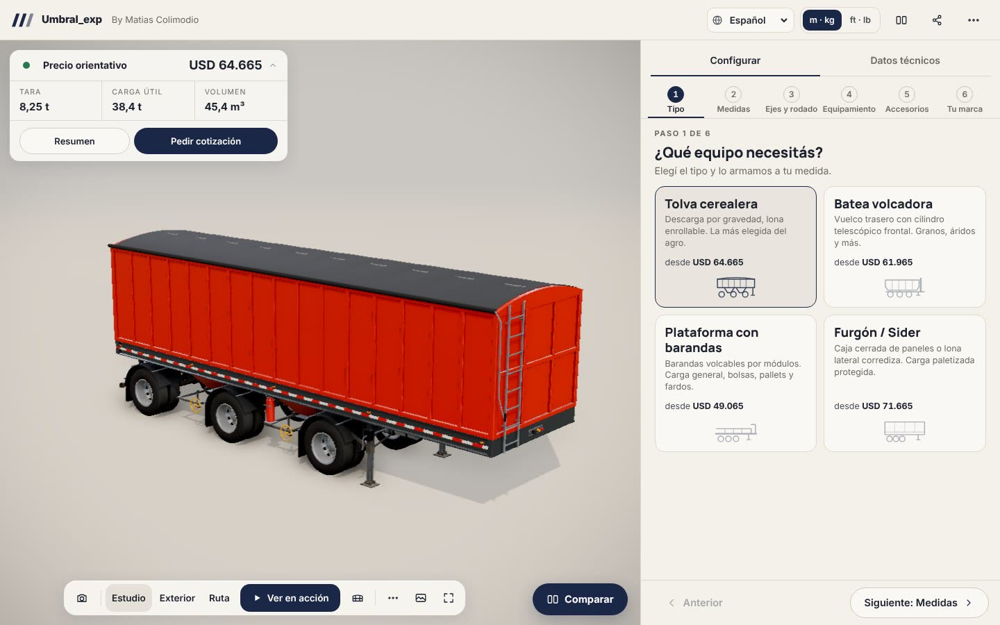
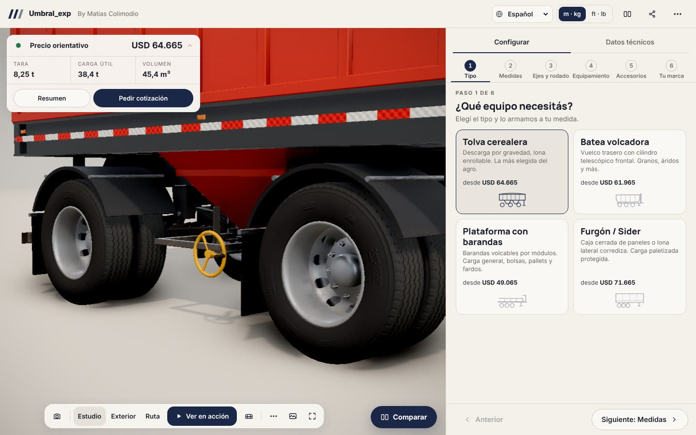
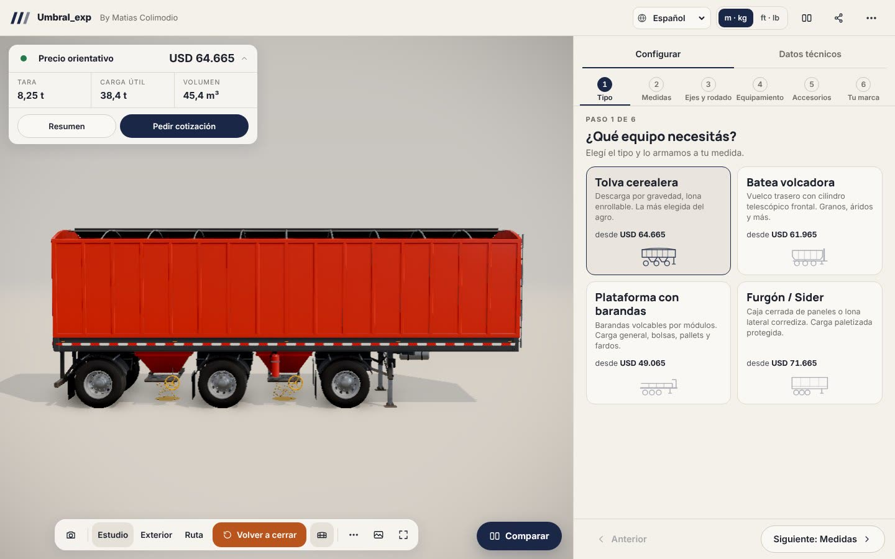
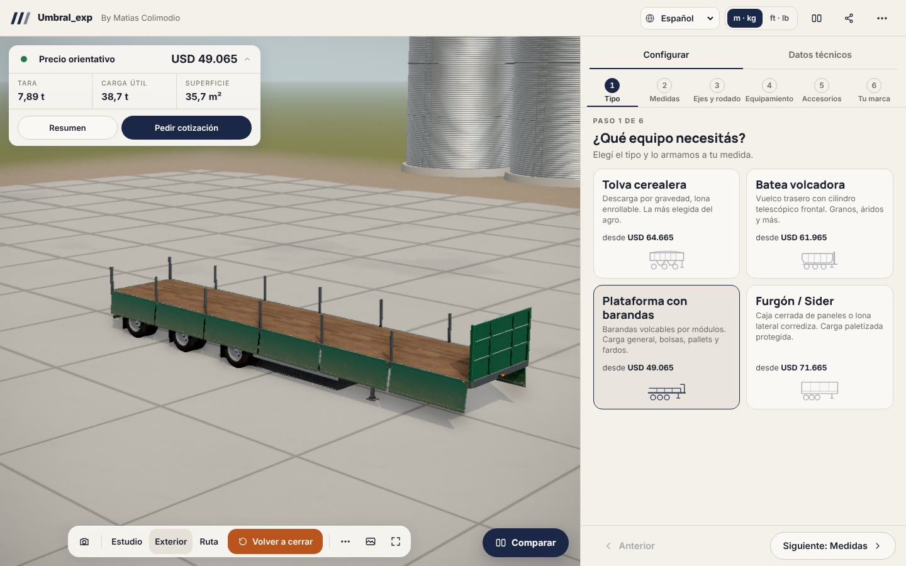
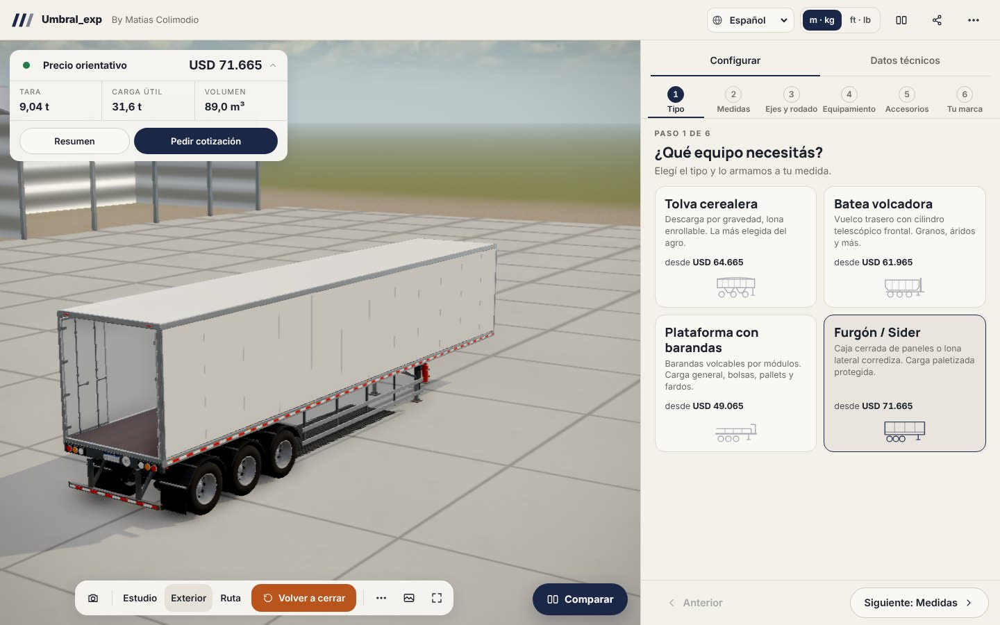
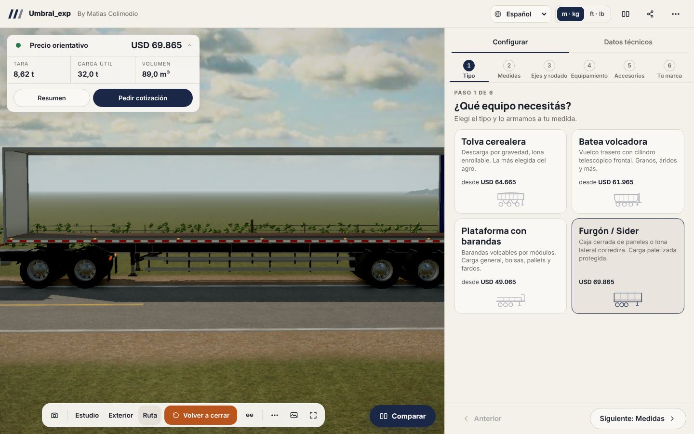
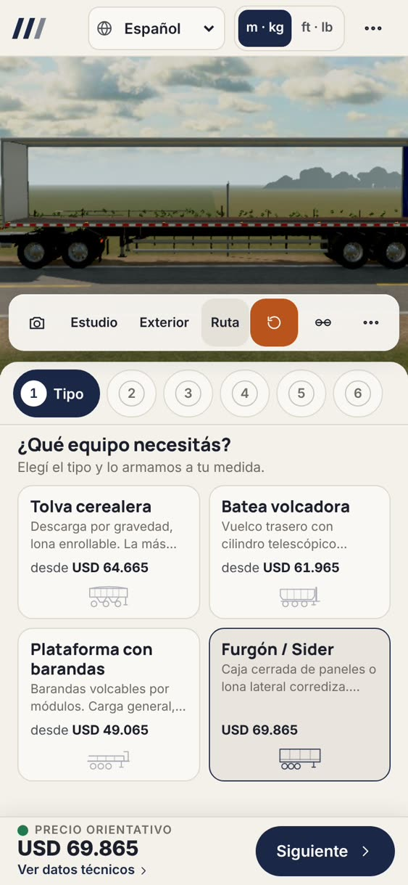
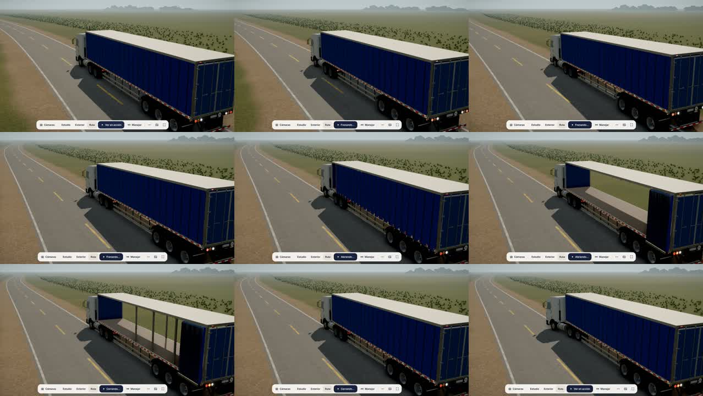

# Informe · Fase 7 (cierre)

Resumen de todo el trabajo de render (fases 0 a 7), medición final contra la línea de base
de la Fase 0, capturas finales, video de la secuencia en la ruta y qué queda en cada nivel
de calidad.

## Cómo leer las mediciones

El contenedor donde trabajé **no tiene GPU**: Chromium dibuja con SwiftShader (por
software). Acá un cuadro a 1920×1080 tarda de 0,4 a 1,5 s solo por el dibujo, así que
**los fps del objetivo (60 en escritorio, 30 en celulares medios) no se pueden medir en
este entorno**: hay que confirmarlos en una PC con placa de video:

```bash
npm run build && npm run preview
```

```bash
npm run bench -- --gpu --headed
```

Lo que sí se mide acá, porque no depende de la placa, es lo que produce tirones en la CPU:
compilación de shaders, reconstrucción del modelo en el hilo principal, subida de texturas y
tareas largas de JavaScript. Con SwiftShader el dibujo de cada cuadro también corre en la
CPU, por eso todas las acciones aparecen con cuadros de más de 50 ms (es el costo del dibujo
por software, no un tirón): lo que importa en la tabla es que **los shaders compilados
durante las acciones son 0** y que **la reconstrucción en el hilo principal bajó de cientos
de ms a decenas**.

Los materiales de la Fase 2 (barniz con piel de naranja, lona con brillo de tela, llantas de
aluminio con anisotropía, vidrio con transmisión) son más caros de dibujar: con dibujo por
software eso se ve como cuadros algo más largos en algunas acciones, aunque en una GPU es
una fracción de milisegundo. Por eso el cuadro más largo en SwiftShader no es comparable
entre fases: la comparación válida es la de las causas.

## Medición final contra la Fase 0

Pasada corta (`--rapido`: Tolva y Furgón/Sider, una opción por paso, Ver en acción en
Estudio y Exterior, Estudio → Exterior → Ruta → Estudio y la secuencia de la Ruta),
render por software. Resultados en `bench/results-2026-11-26-fase7-escritorio.json` y
`bench/results-2026-11-27-fase7-celular.json`. La corrida de escritorio coincidió en parte
con la grabación del video (con prioridad baja), así que sus tiempos pueden estar algo
inflados.

#### Perfil escritorio

| Medida | Antes | Después |
| --- | --- | --- |
| Primer cuadro con el modelo (ms) | 6246 | 5618 |
| Transferido hasta el primer cuadro (KB) | 993 | 1011 |
| Precarga en segundo plano terminada (ms) | – | 55228 |
| Transferido con la precarga (Exterior y Ruta incluidas, KB) | – | 4727 |
| Cuadro más largo (ms) | 3599.9 | 1899.9 |
| Cuadros > 50 ms | 658 | 1535 |
| Acciones con algún cuadro > 50 ms | 35/35 | 39/39 |
| Tarea larga más larga (ms) | 2047 | 1882 |
| Shaders compilados durante las acciones | 2 | 0 |
| Reconstrucciones en el hilo principal | 9 | 7 |
| Tiempo de reconstrucción en el hilo principal (ms) | 683.3 | 125.1 |
| fps órbita estudio | – | – |
| fps órbita exterior | – | – |
| Draw calls máx. por cuadro | 176 | 138 |

Acciones más pesadas (cuadro más largo, tarea larga, shaders compilados, reconstrucción en el hilo principal):

| Acción | Antes | Después |
| --- | --- | --- |
| escena → estudio | 3600 ms · TL 1941 · -1 sh · 0 ms | 1900 ms · TL 1882 · 0 sh · 0 ms |
| tipo → furgon | 2083 ms · TL 1085 · 0 sh · 73 ms | 1133 ms · TL 1107 · 0 sh · 11 ms |
| furgon exterior: volver a cerrar | 2050 ms · TL 2047 · 0 sh · 0 ms | 917 ms · TL 911 · 0 sh · 0 ms |
| escena → exterior | 1983 ms · TL 1935 · 1 sh · 0 ms | 1250 ms · TL 1252 · 0 sh · 0 ms |
| tolva: paso personalizacion | 1817 ms · TL 1817 · 0 sh · 0 ms | 517 ms · TL 514 · 0 sh · 0 ms |
| tolva/accesorios: cajon (interruptor/cantidad) | 1817 ms · TL 1821 · 0 sh · 102 ms | 967 ms · TL 918 · 0 sh · 36 ms |
| tolva/rodado: ejes=tridem | 1767 ms · TL 1754 · 0 sh · 110 ms | 1183 ms · TL 1163 · 0 sh · 26 ms |
| tolva exterior: volver a cerrar | 1767 ms · TL 1766 · 0 sh · 0 ms | 933 ms · TL 924 · 0 sh · 0 ms |
| exterior: órbita de cámara 3 s | 1750 ms · TL 1749 · 0 sh · 0 ms | 967 ms · TL 952 · 0 sh · 0 ms |
| tolva exterior: Ver en acción | 1700 ms · TL 1705 · 0 sh · 0 ms | 1067 ms · TL 1063 · 0 sh · 0 ms |
| tolva: paso especificos | 1667 ms · TL 1669 · 0 sh · 0 ms | 633 ms · TL 636 · 0 sh · 0 ms |
| furgon exterior: Ver en acción | 1650 ms · TL 1640 · 0 sh · 0 ms | 1067 ms · TL 1071 · 0 sh · 0 ms |

#### Perfil celular

| Medida | Antes | Después |
| --- | --- | --- |
| Primer cuadro con el modelo (ms) | 8329 | 8966 |
| Transferido hasta el primer cuadro (KB) | 776 | 794 |
| Precarga en segundo plano terminada (ms) | – | 35582 |
| Transferido con la precarga (Exterior y Ruta incluidas, KB) | – | 4510 |
| Cuadro más largo (ms) | 1233.3 | 366.8 |
| Cuadros > 50 ms | 1432 | 4919 |
| Acciones con algún cuadro > 50 ms | 35/35 | 41/41 |
| Tarea larga más larga (ms) | 1070 | 342 |
| Shaders compilados durante las acciones | 2 | 0 |
| Reconstrucciones en el hilo principal | 9 | 8 |
| Tiempo de reconstrucción en el hilo principal (ms) | 2264.4 | 243.3 |
| fps órbita estudio | 7.3 | 11.8 |
| fps órbita exterior | 4.3 | 8.9 |
| Draw calls máx. por cuadro | 263 | 138 |

Acciones más pesadas (cuadro más largo, tarea larga, shaders compilados, reconstrucción en el hilo principal):

| Acción | Antes | Después |
| --- | --- | --- |
| escena → exterior | 1233 ms · TL 1070 · 1 sh · 0 ms | 217 ms · TL 207 · 0 sh · 0 ms |
| furgon: variante sider | 650 ms · TL 378 · 1 sh · 228 ms | 367 ms · TL 342 · 0 sh · 23 ms |
| tolva/dimensiones: medida Largo de caja + | 633 ms · TL 379 · 0 sh · 359 ms | 250 ms · TL 201 · 0 sh · 41 ms |
| tolva/accesorios: cajon (interruptor/cantidad) | 550 ms · TL 343 · 0 sh · 329 ms | 283 ms · TL 230 · 0 sh · 48 ms |
| tolva/rodado: ejes=tridem | 533 ms · TL 274 · 0 sh · 261 ms | 283 ms · TL 220 · 0 sh · 0 ms |
| tipo → furgon | 517 ms · TL 284 · 0 sh · 250 ms | 283 ms · TL 272 · 0 sh · 22 ms |
| furgon/accesorios: cajon (interruptor/cantidad) | 467 ms · TL 259 · 0 sh · 248 ms | 183 ms · TL 161 · 0 sh · 33 ms |
| furgon/rodado: ejes=1+1+1 | 467 ms · TL 240 · 0 sh · 199 ms | 283 ms · TL 223 · 0 sh · 21 ms |
| furgon/dimensiones: medida Largo de caja + | 433 ms · TL 213 · 0 sh · 198 ms | 250 ms · TL 234 · 0 sh · 34 ms |
| furgon/especificos: variante=furgon | 433 ms · TL 229 · 0 sh · 194 ms | 200 ms · TL 192 · 0 sh · 21 ms |
| escena → estudio | 433 ms · TL 383 · -1 sh · 0 ms | 283 ms · TL 271 · 0 sh · 0 ms |
| tolva exterior: Ver en acción | 317 ms · TL 312 · 0 sh · 0 ms | 183 ms · TL 186 · 0 sh · 0 ms |

Las acciones nuevas (la Ruta) suman cuadros: la ruta dibuja de forma continua mientras el
camión circula, y con dibujo por software cada uno de esos cuadros pasa los 50 ms. Por eso
"Cuadros > 50 ms" sube aunque la causa de tirones de la CPU haya bajado.

### Secuencia de la Ruta (sin shaders compilados en ningún paso)

| Acción | Escritorio: cuadro más largo | Celular (CPU 4×): fps · 1 % · cuadro más largo |
|---|---|---|
| escena → ruta | 1683.2 ms | 5.4 · 4.1 · 283.4 ms |
| ruta: órbita de cámara 3 s | 1466.7 ms | 6.7 · 4.8 · 233.4 ms |
| ruta: 20 s circulando | 1516.6 ms | 5.4 · 4 · 283.3 ms |
| ruta: Ver en acción (frena + abre) | 1599.9 ms | 6.8 · 4.4 · 216.6 ms |
| ruta: volver a cerrar (cierra + arranca) | 1683.3 ms | 5.5 · 4.1 · 266.7 ms |
| ruta: 10 s circulando | 1683.3 ms | 5.4 · 4.3 · 316.7 ms |
| escena → estudio | 1899.9 ms | 16.8 · 9.3 · 283.4 ms |

Con dibujo por software, casi todo el tiempo de esos cuadros es el dibujo en sí (la CPU
haciendo de GPU). Lo que importa acá es que frenar, abrir, cerrar y arrancar no compilan
shaders, no suben texturas ni arman geometría: lo que se mueve son nodos ya armados y
uniforms.

## Capturas finales

Calidad alta en escritorio (1440×900) y media en celular (375×812), render por software.

### Estudio



| Ruedas y suspensión | Compuertas y lona abiertas |
|---|---|
|  |  |

### Exterior (predio de acopio), cada tipo en acción

| Tolva | Batea |
|---|---|
|  |  |
| **Plataforma** | **Furgón** |
|  |  |
| **Sider** | |
|  | |

### Ruta

| Circulando | Frenando hacia la banquina | Sider abierto |
|---|---|---|
|  |  |  |

### Celular (375×812)

| Estudio | Exterior | Ruta |
|---|---|---|
|  |  |  |

## Video de la secuencia

`docs/informes/video/ruta-secuencia.mp4` (15 s, 1280×720, H.264): Sider circulando → "Ver en acción"
→ frena y se va a la banquina → corre la lona → "Volver a cerrar" → cierra → arranca y vuelve
al carril. Grabado cuadro a cuadro (30 cuadros por segundo de tiempo simulado) con
`?debug=1`, que permite avanzar el render manualmente; así el video sale fluido aunque acá
el dibujo sea por software. Es la cámara de seguimiento por defecto, sin retoques. Los
555 cuadros grabados (18,5 s de tiempo simulado) se reproducen a 37 cuadros por segundo
para entrar en 15 s.



## Peso de la primera carga

| | Escritorio | Celular |
|---|---|---|
| Hasta el primer cuadro con el modelo | 1011 KB | 794 KB |
| Con la precarga en segundo plano (Exterior y Ruta incluidas) | 4727 KB | 4510 KB |

Objetivo: ≤ 6 MB en la primera carga. La precarga de Exterior y Ruta se hace en momentos
ociosos después del primer cuadro (y no se hace con "ahorro de datos"); desde esta fase,
además, cada tarea de la precarga espera a que el usuario no esté girando la cámara ni haya
una transición en curso.

## Qué queda en cada nivel de calidad

El nivel inicial se elige por la GPU (detect-gpu, con las tablas servidas desde el propio
sitio) y baja solo si el rendimiento no alcanza. `?calidad=alta|media|baja` lo fija.

| | Alta | Media | Baja |
|---|---|---|---|
| Resolución máx. (DPR) | 2 | 1,5 | 1 (0,75 mientras se mueve la cámara) |
| Sombras | 2048 px | 1024 px | 1024 px |
| Postprocesado | N8AO + SMAA + bloom sutil + viñeta | N8AO a media resolución + SMAA | FXAA |
| Vidrio del tractor | transmisión física | transparente | transparente |
| Refinado al quedarse quieto | 96 muestras: antialiasing, sombras suaves y profundidad de campo (Estudio) | 48 muestras: antialiasing y sombras suaves | 16 muestras: solo antialiasing |
| Vegetación de la Ruta | 100 % | 55 % | 25 % |
| Ruedas | 6,1 k triángulos cerca, 1,6 k desde ~30 m | igual | igual |
| Todo lo demás (materiales, escenas, animaciones, cinemática) | completo | completo | completo |

Ninguna técnica quedó deshabilitada por bajar los fps, porque acá no se pueden medir fps
reales; las que más cuestan (transmisión del vidrio, AO a resolución completa, profundidad de
campo del refinado) ya están solo en alta. Si en la medición con GPU alguna baja de 60 fps en
escritorio medio, se pasa a media en `src/render-kit/quality/tiers.ts`.

## Resumen de todas las fases

| Fase | Qué quedó | Informe |
|---|---|---|
| Errores previos | Modales opacos; "Tu marca" cierra todo; carga en celular calzada con la cámara inicial, cartel sin tapar controles, "· 100 %" sin cortes | [fase-0-1](fase-0-1.md) |
| 0 · Medición | `?debug=1` (r3f-perf con `import()` dinámico + cuadro más largo + memoria de GPU); `npm run bench` (4 tipos × 6 pasos × 3 opciones, Ver en acción, escenas, órbita, secuencia de la Ruta; causas de cada cuadro > 50 ms); comparador | [fase-0-1](fase-0-1.md) |
| 1 · Cero tirones | Geometría en un Web Worker (hilo principal: solo el esqueleto), shaders precompilados en la variante del postprocesado, misma firma de luces en las tres escenas, escenas precargadas y ocultas, fundido cruzado en la GPU, 3 niveles de calidad con detect-gpu | [fase-0-1](fase-0-1.md) |
| 2 · Luz y materiales | Estudio con luz de producto, barniz con piel de naranja, chapa galvanizada, fenólico, lona con brillo de tela, llantas de aluminio anisotrópicas, suciedad por altura, exposición por escena | [fase-2](fase-2.md) |
| 3 · Escenas | Exterior como predio de acopio (hormigón, rejilla de descarga, silos, galpón); Ruta argentina infinita (asfalto, demarcación, banquina, alambrado, postes, mojón, cartel, soja y rastrojo); tractor procedural con interior | [fase-3-4](fase-3-4.md) |
| 4 · El camión en la ruta | Cinemática con remolque desde el perno rey, frenado planificado sin golpe, suspensión, luces; máquina de estados reusable; 3 cámaras; "Manejar" con teclado y joystick | [fase-3-4](fase-3-4.md) |
| 5 · Refinado | Acumulación en la GPU con jitter subpíxel, de luz y de lente; corte inmediato; capturas, Resumen y PDF refinados con tope de 4 s y barra de progreso | [fase-5](fase-5.md) |
| 6 · Modelos | `docs/model-spec.md`, `npm run models:build` (glTF-Transform, meshopt, KTX2/WebP, versión liviana), chaflanes, ruedas de 6,1 k triángulos, LOD de ruedas, carga progresiva | [fase-6](fase-6.md) |
| 7 · Cierre | Este informe; READMEs de `src/render-kit/` y `src/render-kit/vehicle/` | — |

## Lo que se hizo distinto de lo pedido (y por qué)

- **Sin path tracer**: no ejecuta los shaders propios (logo y texto del cliente, suciedad,
  pisos); el refinado por acumulación los conserva (detalle en [fase-5](fase-5.md)).
- **Sin sombras en cascada (CSM)**: con el camión siempre en el origen (ruta infinita) una
  sola sombra ajustada al conjunto da más resolución que las cascadas, con menos pasadas.
- **Sin desenfoque de movimiento**: a 80 km/h con la cámara siguiendo al camión casi no se
  nota y agrega una pasada completa; queda la sensación de velocidad por el suelo y los
  objetos de la ruta.
- **Eje elevable siempre bajo en la ruta**: "Producto a cargar" no tiene estado vacío.
- **Imagen del link (og) fija**: una por configuración necesita un servidor que dibuje 3D.
- **render-kit creado desde cero**: no encontré el del configurador de sembradoras en los
  repositorios accesibles desde la sesión.
- **Tractor procedural**: respeta 4×2 / 6×2 y la distancia del perno rey de cada
  configuración, sin marcas.

## Qué falta confirmar en una PC con GPU

1. `npm run bench -- --gpu --headed` en escritorio con placa media: 60 fps promedio y ningún
   cuadro > 50 ms en cambios de paso, opción, tipo y escena, y en la secuencia de la Ruta.
2. Lo mismo con el perfil celular (`--perfil=celular`, CPU 4× más lenta): ≥ 30 fps.
3. Si algo no llega: bajar esa técnica de nivel en `src/render-kit/quality/tiers.ts`.
