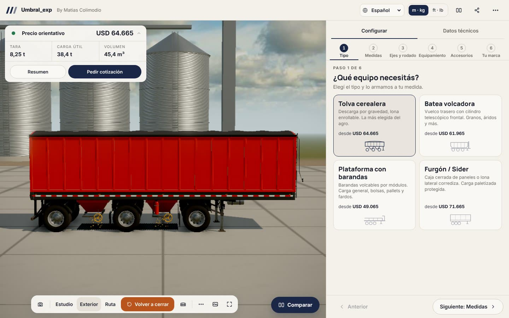
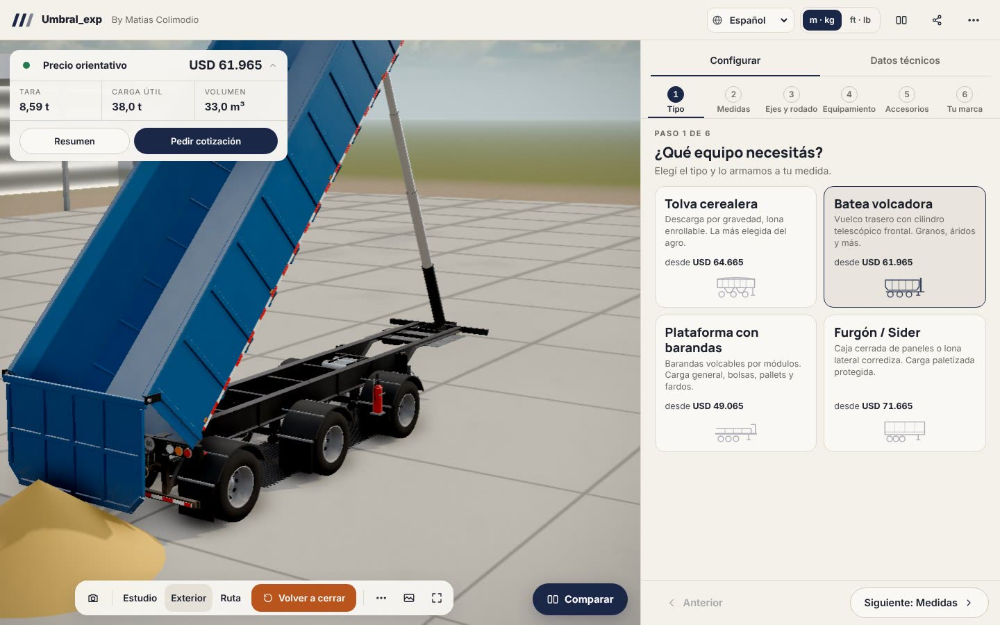
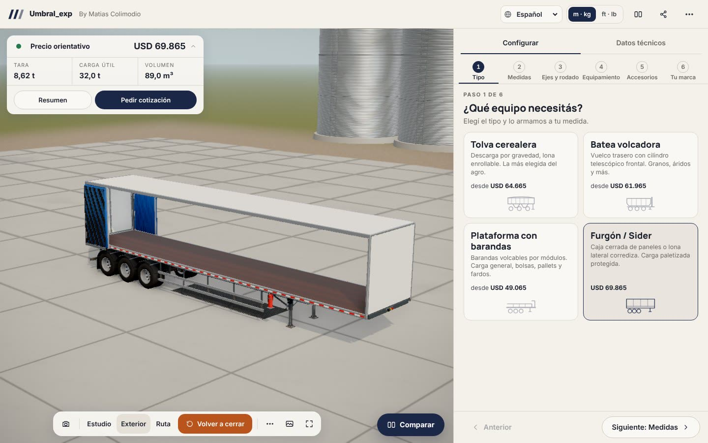
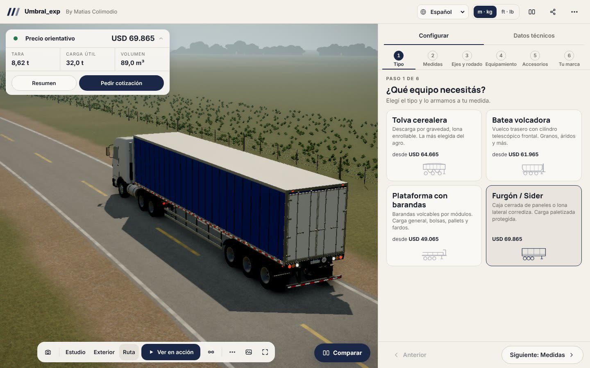
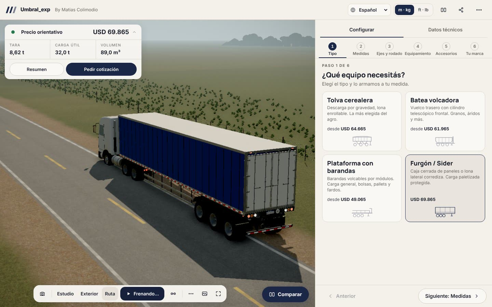
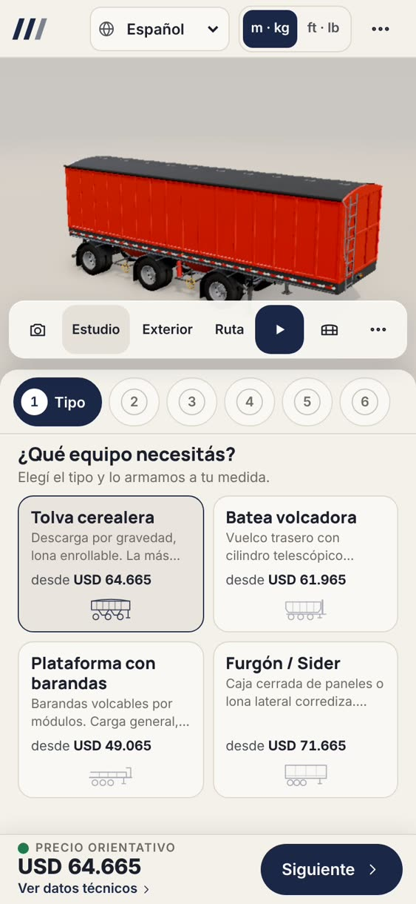
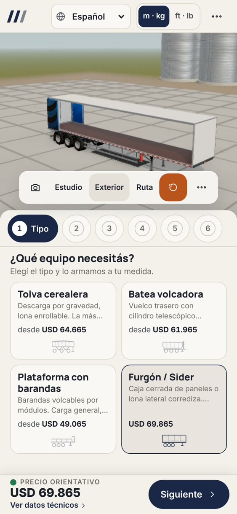

# Informe · Fase 7 (cierre)

Resumen de todo el trabajo de render (fases 0 a 7), medición final contra la línea de base
de la Fase 0, capturas finales, video de la secuencia en la ruta y qué queda en cada nivel
de calidad.

## Cómo leer las mediciones

El contenedor donde trabajé **no tiene GPU**: Chromium dibuja con SwiftShader (por
software). Acá un cuadro a 1920×1080 tarda de 0,4 a 1,5 s solo por el dibujo, así que
**los fps del objetivo (60 en escritorio, 30 en celulares medios) no se pueden medir en
este entorno**: hay que confirmarlos en una PC con placa de video:

```bash
npm run build && npm run preview
```

```bash
npm run bench -- --gpu --headed
```

Lo que sí se mide acá, porque no depende de la placa, es lo que produce tirones en la CPU:
compilación de shaders, reconstrucción del modelo en el hilo principal, subida de texturas y
tareas largas de JavaScript. Con SwiftShader el dibujo de cada cuadro también corre en la
CPU, por eso todas las acciones aparecen con cuadros de más de 50 ms (es el costo del dibujo
por software, no un tirón): lo que importa en la tabla es que **los shaders compilados
durante las acciones son 0** y que **la reconstrucción en el hilo principal bajó de cientos
de ms a decenas**.

Los materiales de la Fase 2 (barniz con piel de naranja, lona con brillo de tela, llantas de
aluminio con anisotropía, vidrio con transmisión) son más caros de dibujar: con dibujo por
software eso se ve como cuadros algo más largos en algunas acciones, aunque en una GPU es
una fracción de milisegundo. Por eso el cuadro más largo en SwiftShader no es comparable
entre fases: la comparación válida es la de las causas.

{{MEDICIONES}}

## Capturas finales

Calidad alta en escritorio (1440×900) y media en celular (375×812), render por software.

### Estudio


| Ruedas y suspensión | Compuertas y lona abiertas |
|---|---|
|  |  |

### Exterior (predio de acopio), cada tipo en acción

| Tolva | Batea |
|---|---|
|  |  |
| **Plataforma** | **Furgón** |
|  |  |
| **Sider** | |
|  | |

### Ruta

| Circulando | Frenando hacia la banquina | Sider abierto |
|---|---|---|
|  |  |  |

### Celular (375×812)

| Estudio | Exterior | Ruta |
|---|---|---|
|  |  |  |

## Video de la secuencia

`docs/informes/video/ruta-secuencia.mp4` ({{VIDEO_INFO}}): Sider circulando → "Ver en acción"
→ frena y se va a la banquina → corre la lona → "Volver a cerrar" → cierra → arranca y vuelve
al carril. Grabado cuadro a cuadro (30 cuadros por segundo de tiempo simulado) con
`?debug=1`, que permite avanzar el render manualmente; así el video sale fluido aunque acá
el dibujo sea por software. Es la cámara de seguimiento por defecto, sin retoques.

## Peso de la primera carga

{{PESO}}

## Qué queda en cada nivel de calidad

El nivel inicial se elige por la GPU (detect-gpu, con las tablas servidas desde el propio
sitio) y baja solo si el rendimiento no alcanza. `?calidad=alta|media|baja` lo fija.

| | Alta | Media | Baja |
|---|---|---|---|
| Resolución máx. (DPR) | 2 | 1,5 | 1 (0,75 mientras se mueve la cámara) |
| Sombras | 2048 px | 1024 px | 1024 px |
| Postprocesado | N8AO + SMAA + bloom sutil + viñeta | N8AO a media resolución + SMAA | FXAA |
| Vidrio del tractor | transmisión física | transparente | transparente |
| Refinado al quedarse quieto | 96 muestras: antialiasing, sombras suaves y profundidad de campo (Estudio) | 48 muestras: antialiasing y sombras suaves | 16 muestras: solo antialiasing |
| Vegetación de la Ruta | 100 % | 55 % | 25 % |
| Ruedas | 6,1 k triángulos cerca, 1,6 k desde ~30 m | igual | igual |
| Todo lo demás (materiales, escenas, animaciones, cinemática) | completo | completo | completo |

Ninguna técnica quedó deshabilitada por bajar los fps, porque acá no se pueden medir fps
reales; las que más cuestan (transmisión del vidrio, AO a resolución completa, profundidad de
campo del refinado) ya están solo en alta. Si en la medición con GPU alguna baja de 60 fps en
escritorio medio, se pasa a media en `src/render-kit/quality/tiers.ts`.

## Resumen de todas las fases

| Fase | Qué quedó | Informe |
|---|---|---|
| Errores previos | Modales opacos; "Tu marca" cierra todo; carga en celular calzada con la cámara inicial, cartel sin tapar controles, "· 100 %" sin cortes | [fase-0-1](fase-0-1.md) |
| 0 · Medición | `?debug=1` (r3f-perf con `import()` dinámico + cuadro más largo + memoria de GPU); `npm run bench` (4 tipos × 6 pasos × 3 opciones, Ver en acción, escenas, órbita, secuencia de la Ruta; causas de cada cuadro > 50 ms); comparador | [fase-0-1](fase-0-1.md) |
| 1 · Cero tirones | Geometría en un Web Worker (hilo principal: solo el esqueleto), shaders precompilados en la variante del postprocesado, misma firma de luces en las tres escenas, escenas precargadas y ocultas, fundido cruzado en la GPU, 3 niveles de calidad con detect-gpu | [fase-0-1](fase-0-1.md) |
| 2 · Luz y materiales | Estudio con luz de producto, barniz con piel de naranja, chapa galvanizada, fenólico, lona con brillo de tela, llantas de aluminio anisotrópicas, suciedad por altura, exposición por escena | [fase-2](fase-2.md) |
| 3 · Escenas | Exterior como predio de acopio (hormigón, rejilla de descarga, silos, galpón); Ruta argentina infinita (asfalto, demarcación, banquina, alambrado, postes, mojón, cartel, soja y rastrojo); tractor procedural con interior | [fase-3-4](fase-3-4.md) |
| 4 · El camión en la ruta | Cinemática con remolque desde el perno rey, frenado planificado sin golpe, suspensión, luces; máquina de estados reusable; 3 cámaras; "Manejar" con teclado y joystick | [fase-3-4](fase-3-4.md) |
| 5 · Refinado | Acumulación en la GPU con jitter subpíxel, de luz y de lente; corte inmediato; capturas, Resumen y PDF refinados con tope de 4 s y barra de progreso | [fase-5](fase-5.md) |
| 6 · Modelos | `docs/model-spec.md`, `npm run models:build` (glTF-Transform, meshopt, KTX2/WebP, versión liviana), chaflanes, ruedas de 6,1 k triángulos, LOD de ruedas, carga progresiva | [fase-6](fase-6.md) |
| 7 · Cierre | Este informe; READMEs de `src/render-kit/` y `src/render-kit/vehicle/` | — |

## Lo que se hizo distinto de lo pedido (y por qué)

- **Sin path tracer**: no ejecuta los shaders propios (logo y texto del cliente, suciedad,
  pisos); el refinado por acumulación los conserva (detalle en [fase-5](fase-5.md)).
- **Sin sombras en cascada (CSM)**: con el camión siempre en el origen (ruta infinita) una
  sola sombra ajustada al conjunto da más resolución que las cascadas, con menos pasadas.
- **Sin desenfoque de movimiento**: a 80 km/h con la cámara siguiendo al camión casi no se
  nota y agrega una pasada completa; queda la sensación de velocidad por el suelo y los
  objetos de la ruta.
- **Eje elevable siempre bajo en la ruta**: "Producto a cargar" no tiene estado vacío.
- **Imagen del link (og) fija**: una por configuración necesita un servidor que dibuje 3D.
- **render-kit creado desde cero**: no encontré el del configurador de sembradoras en los
  repositorios accesibles desde la sesión.
- **Tractor procedural**: respeta 4×2 / 6×2 y la distancia del perno rey de cada
  configuración, sin marcas.

## Qué falta confirmar en una PC con GPU

1. `npm run bench -- --gpu --headed` en escritorio con placa media: 60 fps promedio y ningún
   cuadro > 50 ms en cambios de paso, opción, tipo y escena, y en la secuencia de la Ruta.
2. Lo mismo con el perfil celular (`--perfil=celular`, CPU 4× más lenta): ≥ 30 fps.
3. Si algo no llega: bajar esa técnica de nivel en `src/render-kit/quality/tiers.ts`.
